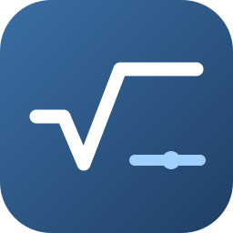

# Math Editor —— DeepSeek Harness 数学公式插件

在会话输入框中像 AxMath 一样可视化编写数学公式：点击工具栏里的 **√** 打开面板，既可以在上方可视化编辑区直接点击方框打字输入公式，也可以点击左侧符号/模板或编辑下方实时双向同步的 LaTeX 源码，再将公式插入草稿。



## 安装

### 方式一：通过 GitHub 仓库命令一键安装（推荐）

打开终端（PowerShell / CMD / Terminal），根据你使用的 DeepSeek Harness 形态执行对应命令：

```sh
# 桌面客户端（DeepSeek Harness Desktop）
dsh plugin --profile desktop add "github:salvaysalva/DSH-Math-Editor#main"

# 本地网页版（通过 dsh web 启动）
dsh plugin --profile web add "github:salvaysalva/DSH-Math-Editor#main"
```

安装完成后，**重启 DeepSeek Harness 客户端（或重启 `dsh web` 服务）**即可在会话输入框工具栏看到 **√** 按钮。

> 说明：`desktop` 与 `web` 两个 Profile 的插件相互独立，请按实际使用的形态选择。你也可以在 DeepSeek Harness 界面的“设置 → 插件”中添加包源 `github:salvaysalva/DSH-Math-Editor#main` 完成安装。

### 方式二：下载源码到本地目录安装（离线或二次开发）

1. 克隆本仓库，或在 GitHub 页面点击 **`Code` → `Download ZIP`** 解压到本地目录（例如 `D:/DSH-Math-Editor`）：
   ```sh
   git clone https://github.com/salvaysalva/DSH-Math-Editor.git
   ```
2. 通过 `link:` 挂载本地目录：
   ```sh
   # 桌面客户端
   dsh plugin --profile desktop add "link:D:/DSH-Math-Editor"

   # 本地网页版
   dsh plugin --profile web add "link:D:/DSH-Math-Editor"
   ```
3. 重启 DeepSeek Harness，在“设置 → 插件”中确认 `Math Editor` 已启用。

## 使用

1. 在会话输入框左侧的工具栏点击 **√**，打开数学公式编辑器。
2. 使用顶部标签切换分类。部分分类提供“更多符号”，可展开该分类的完整面板。
3. **AxMath 式可视化直接编辑**：
   - 点击模板（例如根式 `√⬚`、分式、矩阵、闭合三重积分 `\oiiint_{}{}` 等）后，可视化编辑区会显示所有可编辑虚线占位方框（`⬚`），并自动聚焦到第一个方框中，可直接用键盘输入字母、数字、运算符或中文（自动包裹 `\text{…}`）。
   - 快捷键与命令输入：按 `^` 进入上标、`_` 进入下标、`Ctrl+/` 插入分式；输入 `\` 加命令名（如 `\Omega`、`\frac`、`\mathrm`）可弹出实时命令补全菜单，按 `Space`、`Enter`、`Tab` 或 `{` 上屏；按 `Tab` / `Shift+Tab` 或方向键可在分子、分母、积分上下限、被积函数及矩阵单元格之间自由跳转；支持鼠标拖选后点击模板包裹选中内容，以及 `Ctrl+Z` / `Ctrl+Y` 撤销重做。
   - **字符“倾斜 / 不倾斜”一键切换**：可视化编辑区右上角提供 **倾斜** / **不倾斜** 按钮（默认“倾斜”）。单击按钮即可切换后续输入字符的斜体与竖直正体状态（例如在“不倾斜”状态下直接输入微分算子 `\mathrm{d}`、自然常数 `\mathrm{e}`、单位或正体希腊字母）；若在可视化编辑区中框选了已有字符或子表达式后再单击该按钮，还会同步将选中内容转换为目标正斜体。
   - 下方 LaTeX 源码框与上方可视化编辑区**实时双向同步**，在任意一侧修改都会立即反映到另一侧。
4. 自定义矩阵或向量按钮会显示行数、列数和对齐方式设置；确定后将空矩阵模板插入当前光标位置。
5. 选择 **行内 $…$**、**独立 $$…$$** 或 **纯 LaTeX**，点击“插入”或按 `Ctrl+Enter`，把结果插入会话草稿。按 `Esc` 可关闭面板。

## 与本机 AxMath 面板的对应

按本机 AxMath 2.5.0.1 的当前面板整理了分类、顺序和展开项目。以下数量包含重复符号、模板和可配置矩阵按钮：

| 分类 | 默认面板 | 展开后 |
| --- | ---: | ---: |
| 希腊字母 | 40 | 40 |
| 根式与上下标 | 26 | 26 |
| 运算符 | 71 | 239 |
| 特殊符号 | 62 | 264 |
| 字符修饰 | 44 | 44 |
| 上下修饰 | 23 | 46 |
| 括号 | 32 | 32 |
| 积分 | 20 | 50 |
| 大型运算符 | 29 | 49 |
| 矩阵与向量 | 52 | 52 |
| 箭头 | 63 | 184 |
| **合计** | **462** | **1026** |

按照项目要求，面板不收录没有标准字符表示的 Windows/Apple 标志和两种图案背景，也不把 AxMath 的“恢复幻影”和“自定义符号编辑器”操作当作可插入符号。手势等具有标准 Unicode 表示的字符予以保留。

AxMath 的部分专用命令或图形不能由 Harness 自带的 KaTeX 直接表示，插件使用可解析的 Unicode 字符或组合表达式。例如，两个无标准命令名的图形分别用 `∿` 和 `∿` 叠在等号上方表示。长除法、部分箭头及其他特殊构形采用可编辑的近似排版，因此字形、间距或视觉样式可能与 AxMath 不完全相同。部分 Unicode 字符还依赖系统字体。

## 验证

在项目目录运行：

```sh
npm test
```

测试覆盖分类顺序、明确排除的项目、常用符号和模板位置、可视化直接编辑（含闭合三重积分占位方框输入、`^`/`_` 快捷上下标、行内 `\command` 命令流、结构化退格、撤销重做）、SVG 符号与模板渲染（无缝根号、积分、伸缩括号与角框）、兼容转换、选中文本套模板及快捷键插入。开发时还使用 Harness 所用的 KaTeX 0.18.7 检查了所有保留按钮及自定义矩阵的对齐变体，并在浏览器中验证了明暗主题下的可视化编辑、面板样式与草稿插入。

## 目录结构

| 文件 | 作用 |
| --- | --- |
| `package.json`、`cordis.patch.yml` | 插件清单和宿主加载配置 |
| `index.js` | Host 入口；插件主要运行在浏览器端 |
| `client.js` | 符号数据、预览渲染器、面板组件和草稿插入 |
| `locale/zh.json`、`locale/en.json` | 插件名称、描述和界面文案 |
| `test/editor.test.cjs` | 不依赖宿主进程的自动测试 |
| `icon.svg` | 插件图标 |

## 实现说明

- 面板的本地预览使用内置的小型 LaTeX 解析器；会话中的最终公式由 Harness 的 Markdown 渲染器排版。
- 插入通过宿主提供的 `inputActions.captureInsertion()` 和 `inputActions.insertText(text, span)` 完成，以一次可撤销编辑写入草稿；如果草稿修订号已经失效，面板会提示重试。
- 界面使用宿主主题变量，支持中文和英文，面板和入口分别挂在宿主提供的输入区插槽中。
- 模板由 `tpl(latex, preview, name)` 定义；`latex` 中的 `@` 标记插入后的第一个填写位置。未被预览器识别的命令会显示为红色源码。

## 卸载

在“设置 → 插件”中停用或移除 `Math Editor`，或在终端运行以下命令卸载后重启宿主：

```sh
# 桌面客户端
dsh plugin --profile desktop remove @local/math-editor

# 本地网页版
dsh plugin --profile web remove @local/math-editor
```
